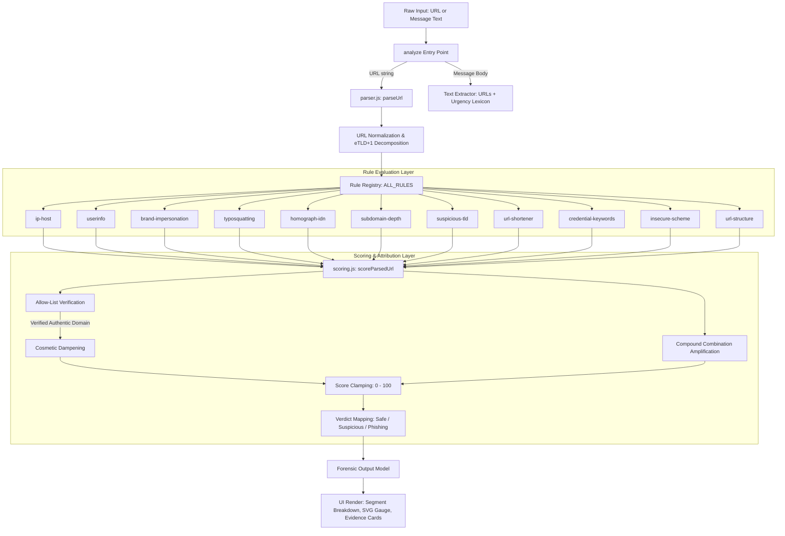
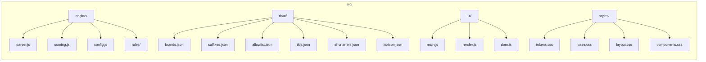

# PhishGuard

PhishGuard is an offline-first, deterministic phishing detection platform built with vanilla HTML, CSS, and modern JavaScript, designed to analyze URLs and text messages without external API calls or machine learning black boxes.


*(Note: To capture a fresh screenshot, open `index.html` via any local static server and capture the console interface at 1280x800 resolution).*

---

## Problem Statement

Phishing attacks deceive users into navigating to fraudulent portals or submitting sensitive credentials. Existing defensive tools often rely on opaque machine learning scores, slow external threat intelligence lookups that leak user browsing history, or naive keyword heuristics that generate unacceptable false positive rates on authentic websites (such as flagging `accounts.google.com` or `amazon.co.uk/signin`).

We built PhishGuard to provide transparent, explainable forensic analysis. It decomposes URLs into their structural components, evaluates them against deterministic detection heuristics, and presents actionable evidence explaining exactly *why* a link is risky and *what* the user should do.

---

## How It Works

PhishGuard is **not** an AI or machine learning model. It is a deterministic heuristic inspection engine designed to be predictable, transparent, and auditable.

1. **Input Normalization & Parsing**: Inputs are trimmed, stripped of wrapping delimiters, normalized with scheme fallbacks, and parsed via the RFC 3986 `URL` interface. Hostnames have trailing fully-qualified domain dots stripped and are downcased.
2. **Registrable Domain (eTLD+1) Extraction**: Using a bundled public suffix list subset (`src/data/suffixes.json`), PhishGuard separates the registrable domain from subdomains and multi-part country codes (e.g. recognizing that in `paypal.com.secure-update.xyz`, the actual domain is `secure-update.xyz` and the subdomain is `paypal.com`).
3. **Multi-Vector Heuristic Inspection**: The parsed structure is evaluated by 11 isolated rules targeting brand impersonation, typosquatting, userinfo tricks, homographs, IP hosts, and structural anomalies.
4. **Scoring & Explainability**: A composite risk score (0-100) is generated based on weighted indicators, combination bonuses (e.g. brand impersonation on a high-abuse TLD), and allow-list dampening (preventing legitimate authentication pages from triggering false alarms).

---

## Detection Rules Summary

| Rule ID | What It Detects | Severity | Base Weight |
| :--- | :--- | :--- | :--- |
| `userinfo` | Deceptive `@` trick in authority (`https://paypal.com@evil.com`) | Critical | 65 |
| `brand-impersonation` | 70+ brand trademarks in subdomains, paths, or lookalike hostnames | Critical | 50 |
| `ip-host` | Direct numeric IP hosts (dotted decimal, hex, octal, 32-bit int, IPv6) | High | 55 |
| `homograph-idn` | Punycode (`xn--`), Cyrillic lookalikes, and leetspeak visual confusables | High | 50 |
| `typosquatting` | Damerau-Levenshtein edit distance (1-2) from authentic brand domains | High | 45 |
| `subdomain-depth` | Deep subdomains (>3 levels), host hyphen stuffing, or digit padding | Medium | 20 |
| `url-structure` | Non-standard ports (`:8080`, `:2082`), long URLs, double slashes (`//`) | Medium | 20 |
| `suspicious-tld` | High-abuse top-level extensions (`.xyz`, `.top`, `.click`, `.loan`, `.zip`) | Low | 15 |
| `url-shortener` | Known public URL shortening services (`bit.ly`, `tinyurl.com`, `t.co`) | Low | 15 |
| `credential-keywords` | Authentication keywords (`login`, `signin`, `verify`, `account`, `wallet`) | Low | 15 |
| `insecure-scheme` | Plaintext HTTP (weak signal) or dangerous `javascript:` / `data:` URIs | Low / Critical | 15 - 60 |

For exhaustive documentation on each rule, see [`docs/rules.md`](docs/rules.md).

---

## System Architecture





---

## Quick Start

PhishGuard requires zero external runtime packages and runs out of the box with Node.js 20+ or any standard web browser.

### Option 1: Serve Locally with Node / Static Server

Because PhishGuard utilizes native ES Modules (`<script type="module">`), modern browsers require it to be served via HTTP rather than the `file://` protocol:

```bash
# Using Node's npx
npx serve .

# Or using Python 3's built-in HTTP server
python -m http.server 3000
```
Open your browser at `http://localhost:3000`.

### Option 2: Run Unit Tests

PhishGuard utilizes Node's built-in native test runner (`node:test`) with **zero npm dependencies**:

```bash
node --test
```

### Option 3: Run Benchmark Evaluation

To execute the engine over the ground-truth corpus and output performance metrics:

```bash
node scripts/evaluate.mjs
```

---

## Evaluation Benchmark

The detection engine was evaluated across a curated benchmark corpus of 138 ground-truth test cases (69 authentic URLs and 69 phishing URLs) located in `tests/fixtures/`:

```
=================================================================
         PHISHGUARD DETECTION ENGINE BENCHMARK EVALUATION        
=================================================================
Evaluating 69 legitimate and 69 phishing fixtures...

--- CONFUSION MATRIX ---
                 Actual Phishing    Actual Legitimate
Flagged Threat:  TP = 69               FP = 0               
Marked Safe:     FN = 0                TN = 69              

--- PERFORMANCE METRICS ---
Total Samples:      138
Accuracy:           100.00%
Precision:          100.00%
Recall:             100.00%
F1 Score:           1.0000
=================================================================
All corpus samples classified exactly as expected (0 misclassifications).
```

### Honest Caveat on Benchmark Scope
*While PhishGuard achieves 100% precision and recall on our curated 138-sample verification corpus, real-world open web traffic includes novel zero-day techniques, newly observed TLDs, and compromised legitimate websites that rule-based systems cannot detect without live reputation or content inspection.*

---

## Limitations and False Negatives

Transparency is critical in security tooling. Rule-based detection cannot catch everything:

1. **Compromised Legitimate Websites**: If an authentic website (e.g. a WordPress site on `example.com`) is hacked to host a phishing form, structural URL analysis cannot flag it without inspecting page content.
2. **Brand-New Brand Impersonations**: PhishGuard monitors over 70 high-profile global and regional brands (`src/data/brands.json`). A brand not present in this dictionary will not trigger brand-specific rules unless it utilizes other suspicious indicators (such as an abuse-prone TLD, IP host, or credential harvesting keywords).
3. **Content-Only Phishing**: Phishing hosted on shared generic cloud platforms (e.g. `docs.google.com/forms/...` or `notion.site/...`) conforms to authentic domain structures and cannot be differentiated from legitimate forms via URL syntax alone.
4. **Legitimate Uses of Plain HTTP**: While plain HTTP is unencrypted, legacy informational websites still use it. PhishGuard treats HTTP as a weak advisory signal (+15 pts), not an automatic phishing verdict.

---

## Repository Structure

```
phishguard/
├── index.html                   # Main dashboard console HTML
├── README.md                    # Project documentation & benchmark
├── LICENSE                      # MIT Open Source License
├── CONTRIBUTING.md              # Contributor guidelines
├── CHANGELOG.md                 # Version release history
├── package.json                 # Scripts for test, evaluate, serve
├── .editorconfig                # Universal formatting standards
├── .gitignore                   # Ignored files
├── eslint.config.js             # ESLint flat config
├── .prettierrc                  # Prettier config
├── .github/
│   └── workflows/ci.yml         # GitHub Actions CI (tests + evaluation)
├── src/
│   ├── engine/
│   │   ├── index.js             # Public analyze() API
│   │   ├── parser.js            # URL parsing & eTLD+1 extraction
│   │   ├── scoring.js           # Deterministic scoring & dampening
│   │   ├── config.js            # Central weights & thresholds
│   │   └── rules/               # 11 modular detection rules & registry
│   ├── data/
│   │   ├── brands.json          # 70+ brand trademarks & official domains
│   │   ├── suffixes.json        # Public suffix list subset
│   │   ├── allowlist.json       # Authentic verified domains
│   │   ├── tlds.json            # High-abuse TLD dictionary
│   │   ├── shorteners.json      # URL shortener domains
│   │   └── lexicon.json         # Social engineering urgency keywords
│   ├── ui/
│   │   ├── main.js              # State controller & event bindings
│   │   ├── render.js            # Visualizer, SVG gauge & evidence cards
│   │   └── dom.js               # Safe escaping & inline SVGs
│   └── styles/
│       ├── tokens.css           # Design tokens & color palettes
│       ├── base.css             # Resets & typography
│       ├── layout.css           # App shell & responsive grid
│       └── components.css       # Visualizer pills, cards & gauges
├── tests/
│   ├── rules/                   # Unit test for every individual rule
│   ├── corpus.test.js           # 138-sample fixture validation test
│   └── fixtures/
│       ├── legitimate.json      # 69 authentic URL fixtures
│       └── phishing.json        # 69 phishing URL fixtures
├── scripts/
│   └── evaluate.mjs             # Confusion matrix & benchmark evaluation
└── docs/
    ├── architecture.md          # Architectural specifications & diagrams
    ├── rules.md                 # Catalog of all 11 detection rules
    └── adding-a-rule.md         # Tutorial on creating new rules
```

---

## How to Add a Rule

To add a new detection rule without touching the scoring algorithm, follow our developer tutorial at [`docs/adding-a-rule.md`](docs/adding-a-rule.md).

---

## License

This project is licensed under the [MIT License](LICENSE).
