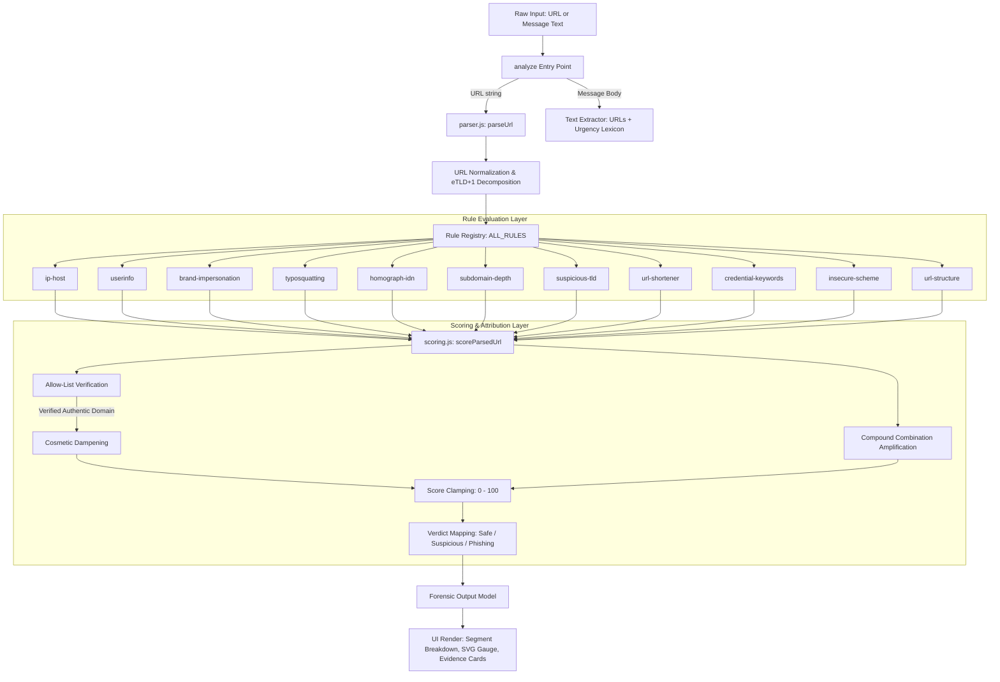
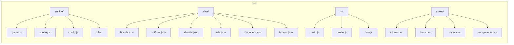

# PhishGuard Architecture Specification

PhishGuard is an offline-first, deterministic, explainable phishing detection platform. It is engineered with **zero external runtime dependencies**, operating entirely via native ES Modules in modern web browsers and Node.js 20+.

```
               ┌────────────────────────────────────────────────────────┐
               │                  User Input (URL / Text)               │
               └───────────────────────────┬────────────────────────────┘
                                           │
                                           ▼
               ┌────────────────────────────────────────────────────────┐
               │              Input Routing & Normalization             │
               │      - Trims whitespace & unwraps delimiters           │
               │      - Injects protocol if absent                      │
               │      - Strips trailing FQDN dot & downcases host       │
               └───────────────────────────┬────────────────────────────┘
                                           │
                                           ▼
               ┌────────────────────────────────────────────────────────┐
               │          RFC 3986 Standard Parser & Suffix Matcher     │
               │      - Extracts scheme, userinfo, port, path, query    │
               │      - Matches longest public suffix (suffixes.json)   │
               │      - Isolates Subdomain vs Registrable Domain        │
               │      - Detects Raw IP hosts (dotted, hex, octal, dec)  │
               └───────────────────────────┬────────────────────────────┘
                                           │
                                           ▼
               ┌────────────────────────────────────────────────────────┐
               │                  Rule Registry Pipeline                │
               │   Runs 11 isolated, side-effect-free heuristic rules   │
               │   Each rule emits: { triggered, evidence, segment }    │
               └───────────────────────────┬────────────────────────────┘
                                           │
                                           ▼
               ┌────────────────────────────────────────────────────────┐
               │             Scoring & Explainability Engine            │
               │   - Checks Exact Allow-List (allowlist.json)           │
               │   - Suppresses cosmetic false positives (Dampening)    │
               │   - Applies Compound Risk Bonuses (e.g. Brand + TLD)   │
               │   - Maps score (0-100) to Safe / Suspicious / Phishing │
               │   - Highlights primary anomalous URL segment           │
               └───────────────────────────┬────────────────────────────┘
                                           │
                                           ▼
               ┌────────────────────────────────────────────────────────┐
               │              Forensic Security Output Object           │
               │  { score, verdict, segments, evidence[], advice[] }    │
               └────────────────────────────────────────────────────────┘
```

## System Architecture Diagram



## Module Directory Structure



## Core Design Tenets

1. **Deterministic Execution**:
   Unlike stochastic LLM or opaque machine learning models that can hallucinate or fluctuate across runs, PhishGuard generates deterministic scores and explicit forensic citations.
2. **Offline Resilience**:
   The engine does not initiate outbound HTTP requests, perform DNS lookups, or contact third-party threat intelligence APIs. It cannot leak user browsing activity, cannot suffer network timeouts, and operates in air-gapped environments.
3. **Defense Against Evasion**:
   By extracting the registrable domain (eTLD+1) prior to inspection, PhishGuard remains immune to subdomain impersonation attacks such as `paypal.com.secure-update.xyz`.
